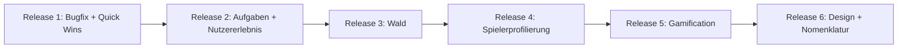

# Ticket-Analyse (Technologie & Fachlichkeit) und Releaseplan

## 1. Technologie- und Facheinordnung

**Technologie-Schichten (wo wird umgesetzt):**

- **Backend (Node/Express/PostgreSQL):** Auth, Tasks, Contests, Teams, Rewards, Messages, E-Mail, Migrationen
- **Frontend (React/TypeScript):** UI, Routing, i18n, Formulare, Admin/Rezeption/Redaktion
- **3D/Canvas (React Three Fiber, Three.js):** Forest/Wald, OrbitControls, Trees
- **E-Mail (Nodemailer):** Verifikation, Benachrichtigungen, künftig Admin-Foto-Mail
- **QR:** Generierung (qrcode.react), Einlesen (jsQR/BarcodeDetector) – Backend liefert Tokens/URLs

**Fachliche Bereiche:**

- **Auth/Registrierung:** Privacy-Akzeptanz, Verifikation, Sprache, Anmelde-QR (URL)
- **Aufgaben (Tasks):** Kategorien, Filter, Layout, Multiple Choice, Quiz, Foto, Mehrsprachigkeit
- **Wald/Forest:** Layout (Stats unter Wald), Steuerung, Fullscreen, Darstellung (Plane, Zoom, Licht), ggf. Hexagon/Höhe
- **Contest/Team:** Fehlermeldungen, Join-QR mit URL, Ranking, Wälder nebeneinander
- **Rewards/Bonus:** bereits umgesetzt (Bonus-QR, Scanner)
- **Admin/Rezeption:** Foto-E-Mail an Admins, Design-System (Admin für Grafiken)
- **Spielerprofilierung:** Introslides, 4 Dyaden, Wald-Charakter, Textbausteine (neues Feature)
- **Sonstiges:** Nomenklatur/UIX, Sihot (separates Projekt), Event-Vorbereitung, Gäste ohne Login

---

## 2. Einordnung der 40 Tickets

| Ticket  | Technologie                                                     | Fachbereich            | Aufwand (grob)           |
| ------- | --------------------------------------------------------------- | ---------------------- | ------------------------ |
| 001     | Backend/DB, ggf. Infrastruktur                                  | System                 | M (abhängig von Ursache) |
| 002     | Backend (Flag), Frontend (Checkbox + Flow)                      | Auth                   | S                        |
| 003     | Frontend (CSS-Variablen), Backend + Admin (Upload/Config)       | Design/Admin           | L                        |
| 004     | Backend, externe API                                            | Integration            | XL (Projekt)             |
| 005     | Frontend (Slides), Backend (optional Speicher)                  | Gameplay               | M–L                      |
| 006     | Frontend (Forest-Seite), Backend (Datenmodell)                  | Forest                 | L                        |
| 007     | Frontend (ForestPage Layout)                                    | Forest                 | S                        |
| 008     | Backend (Punkte-Kategorien), Frontend (Kennzahlen)              | Forest/Tasks           | L                        |
| 009     | Backend (Sperre + Konfig), Frontend (QuizTask)                  | Tasks                  | M                        |
| 010     | Backend (E-Mail an Admins bei Foto-Upload)                      | Admin                  | S                        |
| 011     | Frontend (Contest/Team Join – Fehlerstate)                      | Contest/Team           | S                        |
| 012     | Konfig/Copy (E-Mail-Absender, Texte)                            | Produkt                | S                        |
| 013     | Backend (Ranking-API mit Parametern), Frontend (öffentl. Seite) | Contest                | M                        |
| 014     | Frontend + i18n (Begriffe)                                      | UIX                    | M                        |
| 015     | Backend (anonyme Sessions), Frontend (Gast-Flow), Cookie-Logik  | Auth/Tasks             | L                        |
| 016     | Backend (Join-URL bauen), Frontend (QR mit URL)                 | Contest/Team           | S                        |
| 017     | Backend (EN-Felder), Frontend (i18n, Subtitles)                 | Tasks/Mehrsprachigkeit | L                        |
| 018     | Frontend (LanguageSwitcher sichtbarer platzieren)               | Auth/UIX               | S                        |
| 019     | Backend (Tages-Logik, Punkte), Frontend (optional Hinweis)      | Punkte/Engagement      | M                        |
| 020     | Frontend (TasksPage Layout, Filter)                             | Tasks                  | M                        |
| 021     | Frontend (Routing, Kategorien als Unterseiten)                  | Tasks                  | M                        |
| 022     | Frontend (Zurück-Button in betroffenen Views)                   | UIX                    | S                        |
| 023     | Backend (Levels/Badges), Frontend (Anzeige, Forest)             | Gamification           | L                        |
| 024     | Frontend (Forest Fullscreen)                                    | Forest                 | S                        |
| 025     | Frontend (OrbitControls / Touch – Konflikt Seite vs. Wald)      | Forest                 | M                        |
| 026     | Frontend (ForestScene Zoom-Limits)                             | Forest                 | S                        |
| 027     | Frontend/3D (Höhe, Hexagon)                                     | Forest                 | XL                       |
| 028     | Frontend/3D (Grüne Plane entfernen, nur Wald)                   | Forest                 | M                        |
| 029     | Frontend/3D (Post-Processing)                                  | Forest                 | M                        |
| 030     | Backend (Leserecht), Frontend (Fremdwald anzeigen)              | Forest/Contest         | M                        |
| 031     | Backend + Frontend (mehrere Wälder rendern)                     | Forest/Contest         | L                        |
| 032     | Backend (Punkte abziehen), Frontend (Quiz/Regeln)               | Spieldynamik           | M                        |
| 033     | Frontend (Navigation unten)                                     | UIX                    | S–M                      |
| 034     | Konzeption/Abstimmung                                           | Produkt                | –                        |
| 035–040 | Backend (Dyaden, Speicher), Frontend (Slides, Profil, Wald)     | Spielerprofilierung    | L (Paket)                |

**Legende Aufwand:** S = klein (Tage), M = mittel (ca. 1–2 Wochen), L = groß (Wochen), XL = sehr groß / Projekt.

---

## 3. Releaseplan

### Release 1 (laut Kundenliste)

**Ziel:** Stabilität, sofort spürbare Verbesserungen und die von der Kundenliste priorisierten Themen.

**Umfang (14 Punkte):**

- **001** – App/DB: Ursache klären (Konfig, Netzwerk, Migration), Fix je nach Befund.
- **002** – Privacy bei Anmeldung: Checkbox „Datenschutz akzeptiert“ im Registrierungsflow; Backend speichert Zustimmung.
- **009** – Multiple Choice: bei Falschantwort definierbaren Zeitraum sperren, Anzeige „Probiere es in X Minuten noch einmal“.
- **010** – E-Mail bei Foto-Verifizierung: zusätzlich E-Mail an Admins/Rezeption senden.
- **011** – Contest/Teams: Fehlermeldungen nach erfolgreicher Aktion ausblenden bzw. State zurücksetzen.
- **012** – „Wir sind Luise“: Absender und ggf. Signatur in E-Mails anpassen.
- **016** – Anmelde-/Join-QR: QR-Inhalt als URL (Join-URL mit Token); Backend liefert joinUrl, Frontend encodiert URL im QR.
- **017** – Mehrsprachigkeit: bei Aufgaben und Rewards EN-Felder; Video: Subtitles oder sprachspezifische Anzeige.
- **018** – Spracheinstellung: LanguageSwitcher an zentral sichtbarer Stelle (Navigation/Profil).
- **019** – Login-/Tagespunkte: z. B. 2 Punkte pro Tag wenn Nutzer „drin ist“.
- **020** – Aufgaben: Kacheln verkleinern (zwei Spalten), Filter verbessern.
- **021** – Aufgaben: Kategorien auswählbar, dann erst Aufgaben (Unterseiten wie EarthHero).
- **022** – Zurück-Button: „Zurück zur Aufgabenliste“ wo er fehlt ergänzen.
- **024** – Fullscreen-Modus für den Wald (Fullscreen API).

**Nicht mehr in R1** (verschoben): 007 (Kennzahlen unter Wald), 025 (Wald-Steuerung Touch), 026 (Zoom), 033 (Vier Buttons) → siehe R3 bzw. R6.

---

### Release 2: Spieldynamik & weitere Aufgaben-Themen

**Paket (nach Abzug der in R1 erledigten Themen):**

- **032** – Spieldynamik Punkte verlieren: Regeln definieren (z. B. Falschantwort = Abzug), Backend/Frontend anpassen.

Weitere Aufgaben-/Quiz-Themen, die nicht in der Kundenliste für R1 standen, können hier ergänzt werden.

---

### Release 3: Wald (Darstellung & Steuerung)

**Paket „Wald verbessern“:** 007, 025, 026, 028, 029, 030, 031

- **007** – Kennzahlen unter dem Wald: ForestPage Reihenfolge (zuerst Wald, darunter Stats).
- **025** – Wald-Steuerung: Touch/Pan so begrenzen, dass nur der Canvas bewegt wird, nicht die ganze Seite.
- **026** – Zoom Min/Max: OrbitControls so anpassen, dass Details hochauflösender wirken.
- **028** – Grüne Plane entfernen, nur Waldfläche anzeigen (Referenzbild beachten).
- **029** – Licht und Blur (Post-Processing) für bessere Grafik.
- **030** – Wälder anderer User ansehen (z. B. bei Contest-Ranking).
- **031** – Team/Contest: mehrere Wälder nebeneinander zu einem großen Wald (Rendering-Limit „bis x Stück“).

**Technologie:** Vor allem Frontend/3D (ForestScene, Materialien, Kamera, ggf. neue API für Fremdwälder).

**Später / optional:** 027 (Höhenvariation, Hexagon) als separates Paket wegen Aufwand.

---

### Release 4: Spielerprofilierung (Introslides & Charakter)

**Paket „Spielerprofilierung“:** 035–040, inhaltlich verknüpft mit 005, 006

- **005** – Introslides mit Fragen (bereits in Spezifikation; mit 035–040 umsetzbar).
- **036–040** – Wie in [Spielerprofilierung-Vollversion](specs/Spielerprofilierung-Vollversion.md): Erstes Login mit Skip, 4 Dyaden-Fragen, 5-Punkte-Skala, optionaler Anzeigename, Speicherung der Skalenwerte, „Mehr zu meinem Typ“ mit 4 Textbausteinen, Undecided/Schnecke bei Skip.
- **006** – Charaktere & Grafiken: Tiere dem Wald zuordnen; Forest: erst Wald, dann Charakter (Kurztext), Klick = Langtext, darunter Stats (kann mit 007 und Spielerprofilierung kombiniert werden).

**Technologie:** Backend (neue Tabellen/Spalten für Dyaden, Anzeigename, Typ), Frontend (Slides, Profilbereich, Wald-Charakter-Anzeige), Texte aus Spec.

---

### Release 5: Gamification & weiteres

**Paket „Gamification & Engagement“:** 023, 013

- **023** – Badges/Sticker, Levels, Aufgaben ab Level, Badges beim Charakter (Backend: Levels/Badges; Frontend: Anzeige, Forest-Charakter).
- **013** – Öffentliches Ranking mit Parametern (z. B. „Top Player Today“, Filter); öffentliche Seite oder Embed für Display.

(019 Tagespunkte ist in R1 enthalten.)

**Technologie:** Backend (Levels, Badges, Ranking-API), Frontend (Badges, Ranking-Seite).

---

### Release 6: Design-System & Nomenklatur

**Paket „Design & Wording“:** 003, 014, 033

- **003** – Design-System: zentrale CSS-Variablen (Farben, Fonts), Admin-Seite für essenzielle Grafiken (Logos, App-Thumbs, Charaktere, Buttons).
- **014** – Nomenklatur überarbeiten (zusammen mit UIX; i18n-Keys und Copy).
- **033** – Vier Buttons unten (Navigation) überdenken: UX-Überarbeitung Bottom-Navigation (Layout/Labels/Icons).

---

### Nicht in Reihenfolge / separat

- **004** – Sihot/Buchungssystem: als **separates Projekt** (Variablen/Integration mit externem Team).
- **008** – Wald-Aspekte/Kategorien (Punkte kategorisieren, Kennzahlen differenziert): fachlich an 006/007 anbinden; technisch mittelgroß, kann mit Release 3 oder 4 gebündelt werden.
- **015** – Gäste ohne Anmeldung: größeres Konzept (Cookies, Punkte-Gutschrift); eigener Release oder nach R2.
- **034** – Event-Vorbereitung: Konzeption/Abstimmung, kein reines Dev-Release.

---

## 4. Übersicht Release-Reihenfolge

| Release | Schwerpunkt                                  | Ticket-Nummern                                              |
| ------- | -------------------------------------------- | ----------------------------------------------------------- |
| **R1**  | Laut Kundenliste (Stabilität, Quick Wins, Aufgaben/Mehrsprachigkeit/Tagespunkte) | 001, 002, 009, 010, 011, 012, 016, 017, 018, 019, 020, 021, 022, 024 |
| **R2**  | Spieldynamik, weitere Aufgaben-Themen       | 032                                                        |
| **R3**  | Wald Darstellung & Steuerung                 | 007, 025, 026, 028, 029, 030, 031 (027 optional später)    |
| **R4**  | Spielerprofilierung, Introslides, Charaktere | 005, 006, 035–040                                           |
| **R5**  | Gamification, Ranking                        | 023, 013                                                   |
| **R6**  | Design-System, Nomenklatur, Navigation       | 003, 014, 033                                              |

Die genaue Priorität innerhalb von R1 und die Aufnahme von 008/015 in R3/R4 können nach Kundenwunsch und Ressourcen feinjustiert werden.
